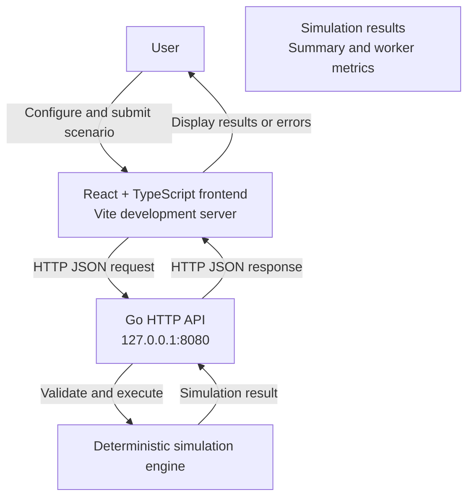
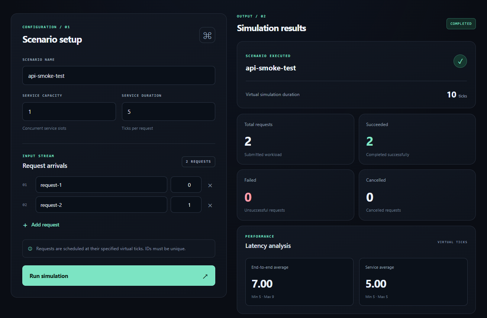

# NetArena

NetArena is a deterministic network and service simulation project written in Go. It models request processing, service capacity, network routing, latency, timeouts, cancellations, worker failures, recovery, and resilience policies.

The project is being developed toward a simulation and strategy game in which players build and operate infrastructure under changing workloads and failure conditions.

## Project status

**Current milestone: simulation mechanics, scenario objectives, HTTP API, and browser workflow**

Implemented:
- Deterministic discrete-event simulation with virtual time and explicit event ordering.
- Request lifecycle management, service capacity, and simulation metrics.
- Topology-aware routing, round-robin distribution, worker-local queues, and network-hop latency.
- Request timeouts and cancellations.
- Worker failure injection and recovery.
- Retry policies and circuit breakers.
- Scenario execution, experiment suites, and comparative reports.
- Scenario objectives with minimum success-rate and maximum average end-to-end latency thresholds, evaluated against simulation results.
- Service-capacity sweeps with JSON and CSV report exports.
- CLI argument validation and automated Go tests.

Not yet implemented or still limited:
- Successful local Windows race-detector execution in a compatible environment (hosted race-enabled CI has passed).
- Durable persistence, authentication, multiplayer, and a complete playable game experience.

See [TASKS.md](TASKS.md) for milestone status and [the verification log](docs/development/verification-log.md) for evidence.

## Quick start

### Prerequisites

- Go 1.27.0, as used by the current project configuration.
- PowerShell on Windows, or a compatible terminal on another supported Go platform.

The simulation and CLI use the Go standard library.

### Verify the project

From the repository root:

```powershell
go test ./cmd/... ./internal/... -count=1
go vet ./cmd/... ./internal/...
go build -o (Join-Path $env:TEMP 'netarena.exe') ./cmd/netarena
```

To display CLI usage:

```powershell
go run ./cmd/netarena
```

The formatting check used by the project is:

```powershell
$unformatted = Get-ChildItem -Recurse -Filter *.go |
    ForEach-Object { gofmt -l $_.FullName }

if ($unformatted) {
    $unformatted
    throw "Go source files are not formatted."
}
```

Race-enabled tests are part of the intended verification workflow. On the current development machine, race-detector verification is blocked by the installed 32-bit MinGW GCC toolchain. A successful ordinary test run does not establish that race-enabled tests pass.


## Architecture



The browser sends JSON scenarios to the Go API. The API validates each request, runs the simulation engine, and returns results or a structured error response. During local development, Vite proxies `/api` requests to the Go server.

### Dashboard preview



## HTTP API and browser workflow

The Go server exposes a health endpoint and a simulation endpoint. The React/TypeScript frontend sends scenarios to the local API and displays returned metrics.

### Start the API server

Open a PowerShell terminal at the repository root:

```powershell
go run ./cmd/netarena-server
```

By default, the server listens on `127.0.0.1:8080`. Set `NETARENA_ADDR` to change the listen address, for example:

```powershell
$env:NETARENA_ADDR = "127.0.0.1:8090"
go run ./cmd/netarena-server
```

Check server health at `http://127.0.0.1:8080/api/v1/health`.

### Start the browser frontend

Use a second PowerShell terminal:

```powershell
Set-Location .\web
npm install
npm run dev
```

Open the local URL printed by Vite. During development, Vite proxies `/api` requests to `http://127.0.0.1:8080`; start the API server first.

### Frontend checks

Run from `web/`:

```powershell
npm test
npm run lint
npm run build
```

The current browser workflow is an initial vertical slice, not a complete game. Durable persistence, authentication, and multiplayer are not implemented.

## Run a service-capacity sweep

The `sweep` command compares a baseline scenario against scenarios with different service capacities.

Run this example from the repository root:

```powershell
go run ./cmd/netarena sweep `
    --capacities 2,4,8 `
    --format json `
    --output .\sweep-report.json
```

To export CSV instead:

```powershell
go run ./cmd/netarena sweep `
    --capacities 2,4,8 `
    --format csv `
    --output .\sweep-report.csv
```

Each command runs four scenarios: the baseline, followed by candidate capacities 2, 4, and 8. Each scenario uses 20 requests with the default settings.

The report files are generated locally and are ignored by Git when saved at the repository root with the default filenames above.

### CLI options

| Option | Default | Description |
|---|---:|---|
| `--capacities` | Required | Comma-separated candidate service capacities |
| `--baseline-capacity` | `1` | Baseline service capacity |
| `--service-duration` | `5` | Service duration in simulation ticks |
| `--requests` | `20` | Number of requests per scenario |
| `--arrival-interval` | `1` | Ticks between consecutive request arrivals |
| `--format` | `json` | Report format: `json` or `csv` |
| `--output` | Required | Destination file for the report |

Capacities must be positive, unique integers and cannot equal the baseline capacity. Duration, request count, and arrival interval must also be positive.

For example, to compare capacities 2 and 6 against a baseline capacity of 1, with 50 requests and a service duration of 4 ticks:

```powershell
go run ./cmd/netarena sweep `
    --capacities 2,6 `
    --baseline-capacity 1 `
    --service-duration 4 `
    --requests 50 `
    --arrival-interval 1 `
    --format csv `
    --output .\custom-sweep.csv
```

## Understanding the reports

### JSON

JSON contains the suite name, scenario-level metrics, and comparison reports. It is the more complete export format.

The following shortened example illustrates a scenario's fields, not a complete sweep report:

```json
{
  "Name": "baseline-capacity-sweep",
  "Scenarios": [
    {
        "Name": "baseline",
        "ServiceCapacity": 1,
        "Duration": 100,
        "TotalRequests": 20,
        "SucceededRequests": 20,
        "FailedRequests": 0,
        "CancelledRequests": 0,
        "TimedOutRequests": 0,
        "SuccessRate": 1,
        "Throughput": 0.2,
        "AverageEndToEndLatency": 43,
        "Retries": 0,
        "WorkerUtilization": 0
    }
  ],
  "Comparisons": []
}
```

The complete JSON report includes the suite name, all scenario rows, and the comparison reports generated by the experiment suite.

### CSV

CSV contains one row per scenario and a stable 13-column header:

```csv
name,service_capacity,duration,total_requests,succeeded_requests,failed_requests,cancelled_requests,timed_out_requests,success_rate,throughput,average_end_to_end_latency,retries,worker_utilization
baseline,1,100,20,20,0,0,0,1,0.2,43,0,0
baseline-capacity-2,2,51,20,20,0,0,0,1,0.39215686274509803,18.5,0,0
```

The numeric values are illustrative results from the default workload. Actual results depend on the scenario configuration.

CSV contains scenario-level metrics; comparison details and additional structured information are available in JSON.

### Metric definitions

| Metric | Meaning |
|---|---|
| `Duration` | Virtual simulation duration in ticks |
| `TotalRequests` | Total requests included in the scenario |
| `SucceededRequests` | Requests that completed successfully |
| `FailedRequests` | Requests that failed |
| `CancelledRequests` | Requests cancelled during the simulation |
| `TimedOutRequests` | Requests that exceeded their deadlines |
| `SuccessRate` | Fraction of requests that succeeded |
| `Throughput` | Successful requests per unit of virtual simulation duration |
| `AverageEndToEndLatency` | Average end-to-end latency among successful requests |
| `Retries` | Retry count reported by the simulation |
| `WorkerUtilization` | Worker-utilization metric reported by the simulation |

Simulation ticks are virtual time units, not wall-clock seconds. Throughput and latency should therefore be interpreted using the simulation's configured time scale.

A capacity sweep helps compare configurations under the same workload. It does not, by itself, establish real-world production performance.

Interpret worker utilization according to the simulation's current metric implementation; it should not be treated as a real-world infrastructure utilization measurement.

## Project structure

```text
NetArena/
├── cmd/
│   ├── netarena/                 # CLI entry point and tests
│   └── netarena-server/           # HTTP API server entry point
├── internal/
│   ├── api/                       # HTTP handlers and API tests
│   └── sim/                       # Simulation engine, scenarios, reports, exports
├── web/                           # React + TypeScript frontend and browser tests
│   ├── e2e/                       # Playwright end-to-end tests
│   └── public/                    # Static assets and dashboard screenshot
├── docs/
│   ├── architecture/              # Architecture and system boundaries
│   ├── development/               # Verification history
│   └── testing/                   # Testing strategy
├── benchmarks/                    # Benchmark work
├── tests/                         # Additional test work
├── deploy/                        # Deployment-related work
├── scripts/                       # Development scripts
├── AGENTS.md                      # AI-assisted development rules
├── TASKS.md                       # Current milestone tracker
├── README.md
└── go.mod
```

The directory layout includes planned work areas; their presence does not imply that a complete frontend or deployment system is available.

## Development and testing principles

- Prefer correctness and deterministic behavior over unnecessary complexity.
- Test lifecycle transitions, event ordering, validation, and failure paths.
- Keep virtual simulation metrics distinct from real host or server measurements.
- Record verification evidence in the development log.
- Do not mark work complete without tests or other appropriate verification.

## Architecture and project documentation

- [Project plan](docs/PROJECT_PLAN.md) — vision and roadmap.
- [Architecture overview](docs/architecture/overview.md) — current boundaries and architectural direction.
- [Testing strategy](docs/testing/TESTING_STRATEGY.md) — testing layers and rules.
- [Task tracker](TASKS.md) — completed and remaining milestones.
- [Verification log](docs/development/verification-log.md) — recorded commands, outcomes, and limitations.
- [AI-assisted development rules](AGENTS.md) — repository-specific engineering instructions.

## Known limitations

- The Go module path remains `example.com/netarena`, a placeholder module path. Consider migrating to the repository's canonical module path separately if external imports or module distribution require it.
- Hosted GitHub Actions CI has passed for the recorded commit; see the verification log. The local race-detector limitation remains documented below.
- Local Windows race-detector verification remains blocked by the installed MinGW toolchain; hosted race-enabled CI passed.
- Capacity sweeps use the existing non-topology scenario API. They do not yet represent topology worker-capacity sweeps.
- The HTTP API and initial browser workflow support scenario configuration, objective evaluation, and simulation results; persistence, authentication, multiplayer, and a complete game experience remain future work.
